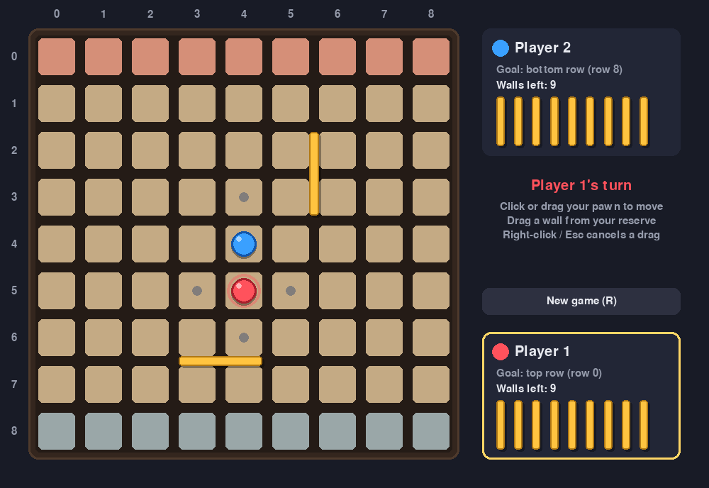
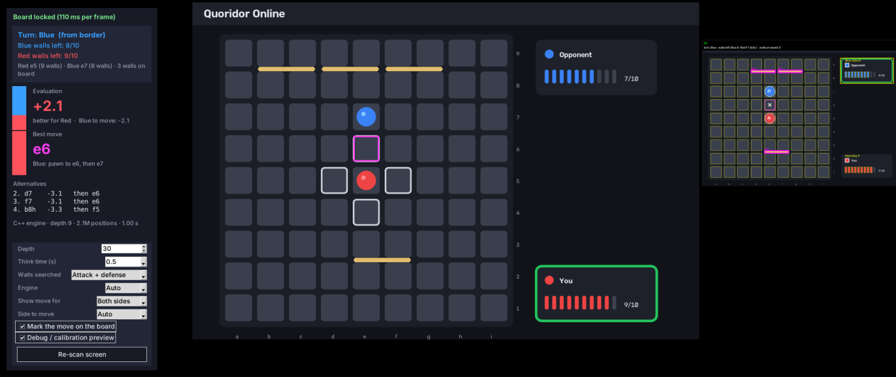
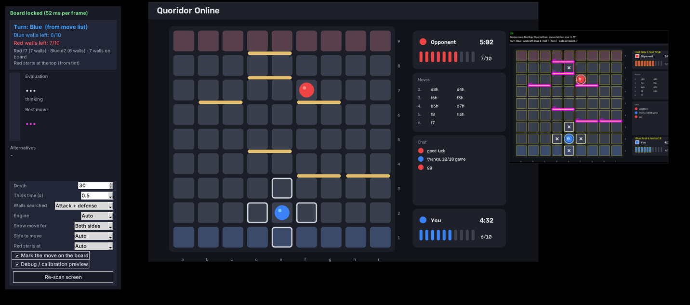
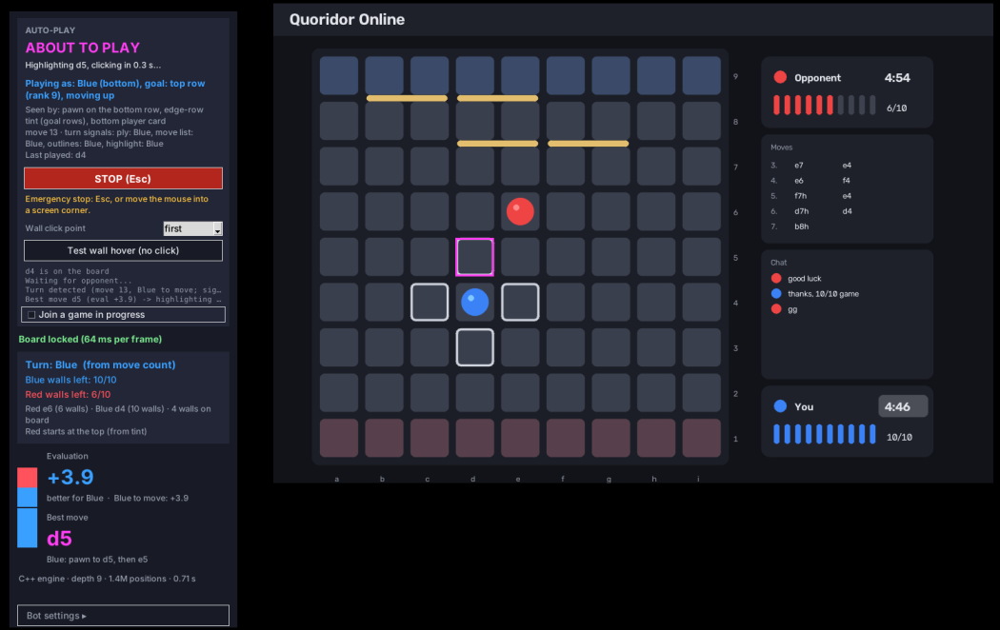

# QuoridorBot

A 2-player [Quoridor](https://en.wikipedia.org/wiki/Quoridor) game emulator in Python, with
three front-ends: a **browser version** (works from a plain link, also on phones), a pygame
desktop GUI and a terminal CLI. Play **Human vs Human** on one device, or **Human vs Bot** against
an alpha-beta search bot with an adjustable search depth (1-30). A **Screen Assistant** can also
watch a game shown on the screen and overlay the bot's best move and evaluation
(see [Screen Assistant](#screen-assistant-live-overlay)), and **Auto-Play Mode** lets the bot
play such a game itself with the mouse (see [Auto-Play Mode](#auto-play-mode)).



## Play in the browser

**Online:** once GitHub Pages is on (see below), the game is at
**https://eifel08.github.io/QuoridorBot/**. Share that link and play on one device (pass and play).
Names can be preset in the URL: `https://eifel08.github.io/QuoridorBot/?p1=Alice&p2=Bob`.

**Locally** (Python only, nothing to install):

```bash
python3 main.py --web
```

That serves the `web/` folder at http://localhost:8000 and opens a browser tab
(`--port 9000` to change the port, `--no-browser` to skip opening a tab). Any static file
server works too, e.g. `cd web && python3 -m http.server`.

The web version is plain HTML/CSS/JavaScript in `web/` with no build step and no external
libraries. `web/engine.js` is a port of the Python rules, and `tests/test_web_engine.py`
checks that it computes exactly the same legal moves, legal walls and path lengths as the
Python engine on a few hundred random positions. It also has *Undo*, editable player names,
and a console API (`Quoridor.state()` returns the same dict as `BoardState.to_dict()`).

### Turning on the GitHub Pages link (one-time)

1. Merge this work into the `main` branch.
2. On GitHub: **Settings -> Pages -> Build and deployment -> Source: GitHub Actions**.
3. Every push to `main` then runs the tests and publishes `web/` via
   `.github/workflows/pages.yml` (it can also be started by hand from the *Actions* tab).

## Game modes

Every front-end lets you pick the mode before a game:

| | Browser | Desktop window | Terminal |
|---|---|---|---|
| Choose the mode | *Human vs Human / Human vs Bot / Bot vs Bot* switch at the top | start menu | prompt at start |
| Search depth (1-30) | slider | slider (or arrow keys) | prompt |
| Think-time cap | dropdown (1 s ... no limit) | buttons | prompt |
| Play Red (first) or Blue | dropdown | buttons | prompt |

- **Human vs Human**: two people take turns on the same computer. On the desktop a bot can
  evaluate the position in the background (see [Eval display](#eval-display-desktop-window)).
- **Human vs Bot**: you play against the alpha-beta bot. After each bot move, the depth it reached,
  the number of positions it searched, the time it took and its evaluation are shown (under the board in
  the browser, in the side panel on the desktop, after the move in the terminal).
  In the browser, *Undo* takes back your move and the bot's reply.
- **Bot vs Bot**: two bots with independent settings play each other while you watch, or run
  hundreds of games without a board. See the next section.

Shortcuts: `python3 main.py --mode bot --depth 6 --time-limit 3 --play-as 2` skips the desktop menu
(add `--cli` for the terminal). In the browser, `?mode=bot&depth=6` preselects the mode and depth.

## Eval display (desktop window)

The desktop GUI can show chess-style **evaluation bars** beside the board, filled with Red from the
bottom and Blue from the top (Red starts at the bottom, Blue at the top). The number is the
**backed-up search score** — the value the alpha-beta search proved for the position — not a
static guess.

| Readout | Meaning |
|---|---|
| `+1.5` | about one and a half steps ahead (10 engine points = 1 step of shortest-path difference; the wall reserve and tempo count in the same unit) |
| `-0.8` | behind by 0.8 steps |
| `M3` | forced win: reaches the goal in 3 of its own moves whatever the opponent does |
| `-M5` | forced loss: the opponent reaches its goal in 5 of its moves whatever this side does |
| `Won` | (Human vs Human) the game is over |

Win/loss scores are ply-adjusted (`WIN - ply`), so a winning bot takes the fastest win and a losing
bot plays the longest defence (e.g. it uses a wall to turn `-M1` into `-M2`).

### Bot vs Bot

Each bot has an **Eval: on/off** button in the menu (on by default). A bot's bar shows **its own**
search score after each of its moves, written in its colour; positive means good for that bot.
With both bots on, the bars are on **opposite sides of the board**: Red's on the left with its
number below it, Blue's on the right with its number above it. The two bots can disagree (they
search with their own depth, time and wall settings).

```bash
python main.py --mode bots --bot1 ab:depth=30,time=1 --bot2 ab:depth=30,time=1,walls=attack
```

### Human vs Bot

**Eval: on/off** next to the colour buttons (on by default). The bot's bar appears on its side of
the board (left if the bot is Red, right if it is Blue) and updates after each bot move. Turn it off
if you don't want to know what the bot thinks. `--eval off` does the same from the command line.

```bash
python main.py --mode bot --depth 30 --time-limit 2 --eval on
```

### Human vs Human

Off by default. In the menu choose **Show eval** and the **engine that evaluates**: the C++ engine
with *attack only*, *attack + defense* or *all walls*, or the *Python bot*. A bot then evaluates
every new position in the background while you think, for **at most 1 second per position**, so
the game never waits for it. The single bar is on the left; its number is written in the colour of
the side it favours, at that side's end of the bar (`+2.0` in Red at the bottom = Red is two steps
ahead). The search depth and time are shown under *New game*. If the C++ engine has not been built
the Python bot is used.

```bash
python main.py --mode human --eval-engine both
```

`--eval-engine attack|both|all|py` turns the Human vs Human eval on with that engine;
`--eval on|off` switches the eval bars of every mode. The terminal version (`--cli`) prints each
bot's eval after its move (`eval +1.5`, `eval M3`).

## Screen Assistant (live overlay)

The Screen Assistant watches the screen for a Quoridor game, reads the position, lets one of
our bots search it and shows the result live: a marker on the board for the recommended move
and an always-on-top panel with the eval bar (`+1.5` / `M3` / `-M5`, Red from the bottom, Blue
from the top), the best move and alternatives.



Use it to analyse your own games, games against bots, or games you are watching. Most sites
do not allow engine help in rated games against other people, so don't use it there.

### Setup

```bash
pip install -r requirements-assistant.txt
```

```bash
python build_engine.py
```

The first installs `mss` (screen capture), `opencv-python` and `numpy`. The second builds the
C++ engine; without it the assistant uses the slower Python search. The windows use Tk, which
comes with Python on Windows and macOS (Linux: `sudo apt install python3-tk`).
Optional: `pip install pytesseract` plus the [Tesseract](https://github.com/tesseract-ocr/tesseract)
program lets the assistant also read the `X/10` wall counters and the move list as text. It
is recommended for timed / online games, where the move list is the best turn indicator.

| Command | What it does |
|---|---|
| `python main.py --assistant` | start the assistant with the default bot (`ab:depth=30,time=1`) |
| `python main.py --assistant ab:depth=8,time=3,walls=attack` | choose the bot ([spec format](#bot-settings); `ml:model=best.pt` works too) |
| `python main.py --assistant-demo` | assistant plus a self-playing mock game, to try it without a real game |
| `python main.py --assistant-demo timed` | the same with the online layout: clocks, move list, chat, no green border, Blue at the bottom |
| `python main.py --assistant --debug-preview` | open the calibration preview at start |
| `python main.py --assistant --monitor 2` | watch the second monitor (`0` = all monitors) |
| `python main.py --assistant-image shot.png` | parse a saved screenshot, print what was read, write `shot.parsed.png` |

Other options: `--scan-fps 5` (captures per second), `--no-overlay` (panel only),
`--vision-profile my.json` (colour thresholds, see below). The start menu of the desktop
window (`python main.py`) also has a **Screen Assistant** button.

Depth, think time, walls searched (attack / attack + defense / all) and engine (C++ / Python)
can be changed in the panel while it runs; the current position is searched again at once.

### What it expects on screen

Two variants of the same UI are supported, and they are told apart automatically.



- **Board, left:** a 9x9 grid of square cells with gaps between them, files `a`-`i` under it
  and ranks `1`-`9` on its right. One red and one blue pawn. Walls sit in the gaps and may have
  any colour. The white/grey outlines on legal target squares are ignored when looking for pawns
  and walls.
- **Orientation:** either player can be at the bottom. Each player's **home row** (top row or
  bottom row) is shaded in that player's colour, which tells who started where and therefore
  which row each player has to reach.
- **Player cards, right of the board:** one at the top and one at the bottom, each with a dot
  in the player's colour, a bar of wall ticks and an `X/10` readout.
- **Local games:** the card of the player to move has a **green border**.
- **Timed / online games:** no green border. The cards also show clocks (`5:02`), and a move
  list (`1. f1 e8`, `2. f2 e7`, `3. f3`) and a chat box sit between the two cards.

The board and the cards are found automatically, at any position and size (squares of about
35 px or more), in light and dark themes. Nothing has to be clicked or measured.

### How the position is read

| What | How |
|---|---|
| Board | a 9x9 lattice of equal squares is searched on the whole screen once; afterwards only that spot is re-checked each frame, and the search runs again if the board moves |
| Orientation | the top and the bottom row are compared with the rows in between: the redder one is Red's home row. Without any tint the first position decides (each pawn is still on its own side) and is remembered; *Red starts at* in the panel overrides it |
| Pawns | the cell whose centre is red / blue and differs from the cell's own corners |
| Walls | each groove segment is compared with the usual groove colour; occupied segments are paired into walls. A half-placed or hovering wall makes the frame "not readable" and is skipped |
| Player cards | the round blob of each colour that has a row of wall ticks next to it. Coloured dots in the chat, avatars or a red clock are not mistaken for it; with no ticks left, the two blobs farthest apart are the cards |
| Walls left | the tick bar of each card; the `X/10` text if pytesseract is installed (clock times such as `5:02` don't match it); both are checked against the number of walls on the board (`20 - blue - red`). If one card can't be read, its count comes from the board |

**Side to move**, first match wins:

1. *Side to move* chosen in the panel.
2. **Green card border** (local games).
3. **Move list** (needs pytesseract): Red moves first, so a last row with one move
   (`3. f3`) means Blue is to move, and a full row (`3. f3 e6`) means Red is. The reader goes by
   the columns the words stand in, so a misread character does not matter, and it gives no
   answer rather than a doubtful one (for example when only a row's number was readable).
4. **Legal-move outlines** on the board, when they are legal moves of exactly one player.
5. **History:** the move that was just seen being made (a moved pawn or a spent wall).
6. **Move parity:** Red moves first, so with an even number of moves played it is Red's turn.
   Moves played = walls placed (`(10 - red) + (10 - blue)`) + pawn steps, with the pawn steps
   estimated from each pawn's distance to its start square. A jump over the other pawn breaks
   that estimate; once the assistant has seen a move being made it corrects for this.

If the move list or the parity rule names the player who was just seen moving, the assistant
waits a few frames for the list to catch up and otherwise trusts the move it saw.

A position is passed to the engine only when it has been identical for two frames and differs
from the last one searched, so identical frames and sliding pawns cost nothing. If the
indicators contradict each other (wall counts don't add up, or an indicator still marks the
player who just moved) it waits a few more frames first. A new position cancels the search
that is still running.

The bots always think with Red moving up the board. A flipped game is mirrored top to bottom
for them and their moves are mirrored back, so the marker and the notation always match what
is on the screen (`e1` is the bottom row whoever owns it).

### Panel and overlay

- **State:** turn (and where it was read from), walls left for Blue and Red, pawn squares, and
  which side Red started on (and where that was read from).
- **Evaluation:** the backed-up search score in the [same notation](#eval-display-desktop-window)
  as the desktop game: the big number is written from the side it favours, in that side's
  colour, with the side to move's own score next to it. Each colour fills the bar from its own
  home side, so the bar turns over with the board.
- **Best move and alternatives** in board notation: `e2` is a pawn move to e2; `e3h` is a
  horizontal wall above e3 and f3; `d4v` is a vertical wall to the right of d4 and d5 (a wall is
  named after its lower-left square). Each line also shows the reply the engine expects.
  Alternatives are searched with a smaller budget than the best move, so their scores are
  approximate.
- **Marker:** the target square (with an arrow from the pawn, on Windows) or the exact wall slot
  is outlined in magenta on the board. *Show move for* limits this to Red's or Blue's turns.
- **Windows:** the marker is a transparent click-through window, and all assistant windows are
  hidden from screen capture, so they can sit anywhere.
  **macOS / Linux:** Tk cannot make a window click-through there, so the marker is an outline
  made of four thin strips (the square under it stays clickable), and the panel and preview
  are blanked out of each captured frame. They are moved off the game once when it is found;
  keep them off it. macOS needs the *Screen Recording* permission for the terminal or Python.
  Linux needs X11 (not Wayland).

### Calibration and troubleshooting

Tick **Debug / calibration preview** in the panel (or start with `--debug-preview`). The
preview shows the captured game with everything the parser detected drawn on it: cell grid
(yellow), pawns with their squares, walls with their names (magenta), legal-move outlines
(crosses), the card dots and counted ticks, the active card, plus a text line with turn,
walls left and warnings. `--assistant-image shot.png` produces the same picture from a file.

| Problem | What to do |
|---|---|
| "Looking for a Quoridor board" | the whole board must be visible on the watched monitor (`--monitor`); press *Re-scan screen* after changing the layout |
| a pawn or the turn is not found | the site's colours are outside the defaults: put the changed values in a JSON file and pass `--vision-profile` |
| walls are missed or invented | lower or raise `wall_delta` in the profile |
| wall counts are wrong | the preview shows which ticks were counted; install pytesseract for the text readout, or rely on the board check |
| turn is wrong or unknown | the panel shows where the turn came from; install pytesseract for the move list, or set *Side to move* |
| the players' directions are swapped | set *Red starts at* in the panel; if the UI shades the goal rows instead of the home rows, put `"tint_marks": "goal"` in the profile |

Profile keys and defaults (hues are OpenCV's 0-179 scale):

```json
{
  "red_hues": [[0, 12], [165, 179]],
  "blue_hues": [[95, 135]],
  "active_hues": [[38, 90]],
  "min_saturation": 90,
  "min_value": 90,
  "pawn_fill": 0.3,
  "wall_delta": 45.0,
  "hint_delta": 14.0,
  "sidebar_width": 1.3,
  "ocr": true,
  "tint_delta": 6.0,
  "tint_marks": "home"
}
```

The parser has been tested on mock screenshots of both variants and both orientations
(`quoridor/vision/synthetic.py`, `tests/test_vision.py`), not yet on the real site, so expect to
check the preview once and possibly adjust the profile.

## Auto-Play Mode

Auto-Play is a separate mode built on the Screen Assistant. It reads the game the same way,
and in addition **plays the bottom player's moves with the mouse**: it works out which colour
is at the bottom, follows the game from the first move, and whenever it is its turn it clicks
the engine's move on the board. The panel keeps showing the eval bar and the planned move.



It takes over the mouse while it moves, and it plays for you. Use it where a bot is allowed:
your own games against bots, test games with friends who know, or a bot account. Most sites
forbid engine play against other people.

### Setup and launch

```bash
pip install -r requirements-autoplay.txt
```

This adds `pyautogui` (mouse control) and `pynput` (Esc as a system-wide stop key on macOS and
Linux) to the Screen Assistant's requirements. macOS also asks for the *Accessibility*
permission for the terminal or Python.

| Command | What it does |
|---|---|
| `python main.py --autoplay` | open Auto-Play with the default bot (`ab:depth=30,time=1`) |
| `python main.py --autoplay ab:depth=12,time=2,walls=attack` | choose the bot ([spec format](#bot-settings)) |
| `python main.py --autoplay-demo` | Auto-Play plus a clickable mock game, the bot as Red (moves first) |
| `python main.py --autoplay-demo blue` | the same with the bot as Blue (the opponent moves first) |
| `python main.py --autoplay --click-profile my.json` | how moves are entered on your site (see below) |
| `python main.py --autoplay --join` | also take over a game that is already running |

The desktop start menu (`python main.py`) has its own **Auto-Play Mode** button above
*Screen Assistant*. `--monitor`, `--scan-fps`, `--debug-preview` and `--vision-profile` work as
for the assistant. Depth, think time, walls and engine can be changed in the panel.

**It starts switched off.** Open the game so that the start position is visible, then press
**Start auto-play** in the panel (`--armed` presses it at launch). The button turns into a red
**STOP**.

### Emergency stop

Any of these halts the bot at once, also in the middle of a mouse movement, and switches
Auto-Play off until you press *Start* again:

- **Esc**, in any window (Windows: built in; macOS / Linux: needs `pynput`, otherwise Esc only
  works while the panel is the active window, and the panel says so);
- moving the **mouse into a corner of the screen** (pyautogui's fail-safe);
- the red **STOP** button, or closing the panel.

The bot also stops by itself, and tells you why, when a click did not change the board after
a retry, when the board shows something it did not expect, or when it lost count of the moves.

### Which colour it plays

Auto-Play plays **only the bottom player**. At the start position it reads three signs and
they must not contradict each other: the pawn standing on the bottom row, the tint of the
bottom row, and the colour of the lower player card. The colour is then locked for that game
and shown in the panel ("Playing as: Blue (bottom)", with the signs it was read from). A new
start position starts a new game and locks the colour again.

### How it knows it is its turn

All of these are combined, and the bot clicks only when the first one says it is its turn and
none of the others says it is the opponent's:

| Signal | How it is used |
|---|---|
| **Move count** | counted from move 0: every change of the board must be exactly one legal move of the player whose turn it is (Red moves first: even count = Red, odd = Blue). Two moves seen at once are accepted if they split into one legal move each. Anything else stops the bot |
| **Clocks** | only the running clock changes, so the pixels of the two player cards are compared over a few seconds: if the opponent's card keeps changing and the bot's does not, it waits. If one card is brighter whenever its player is to move (a highlighted clock box), that is learned during the game and used as well |
| **Legal-move outlines** | outlines of the opponent's moves block the click. Once the site has shown outlines on the bot's turn, the bot waits for them (up to 5 s) before moving |
| **Green border** | a border on the opponent's card blocks the click |
| **Move list** | a list that shows the opponent to move makes the bot wait up to 6 s for it to catch up; it is then overruled, because OCR can misread a row |
| **State-change lock** | after a move the bot does nothing until two frames in a row show the board with that move on it (or that move plus the opponent's legal reply). If nothing changed after 4 s it tries once more, then stops |

The panel shows the state (`WAITING FOR OPPONENT`, `THINKING`, `MOVING`), the move count and
what each signal currently says.

### How moves are clicked

- **Pawn move or jump:** the cursor glides to the centre of the target square, rests there
  briefly so the site registers the hover, and clicks.
- **Wall:** the cursor goes into the gap between the squares the wall lies along, and clicks.
  A wall touches two squares on each side; the **wall click point** says where in the gap:

  | `wall_click` | Horizontal wall `e3h` (above e3 and f3) | Vertical wall `d4v` (right of d4 and d5) |
  |---|---|---|
  | `first` (default) | in the gap above **e3** | in the gap right of **d5** (the upper square) |
  | `second` | in the gap above **f3** | in the gap right of **d4** (the lower square) |
  | `center` | at the crossing point between e3 and f3 | at the crossing point between d4 and d5 |

  Sites differ in which wall they offer for a hovered gap. Before clicking, the bot looks at
  the site's own preview: if the previewed wall is not the intended one it does not click,
  tries the other points, and keeps the one that previews the right wall (the *Wall click
  point* box in the panel changes accordingly). **Test wall hover (no click)** moves the cursor
  to the click point of a sample wall so you can check the preview yourself.
- After every move the cursor returns to where it was, or below the board if it was on it,
  so it never rests on the board and hides nothing from the parser.

Everything about clicking is in one small JSON file (`--click-profile`); the defaults:

```json
{
  "pawn_click": "target",
  "wall_click": "first",
  "wall_gesture": "click",
  "wall_key_h": "",
  "wall_key_v": "",
  "move_seconds": [0.1, 0.3],
  "hover_pause": 0.2,
  "press_seconds": 0.05,
  "check_preview": true,
  "confirm_timeout": 4.0,
  "retries": 1,
  "think_delay": 0.0
}
```

| Key | Meaning |
|---|---|
| `pawn_click` | `target` = click the target square; `pawn-then-target` = click the pawn first; `drag` = drag the pawn |
| `wall_click` | where in the gap a wall is clicked (table above) |
| `wall_gesture` | `click`, or `drag` = drag a wall from the bot's wall reserve (its tick bar) to that point |
| `wall_key_h` / `wall_key_v` | a key to press before a horizontal / vertical wall, for sites with a wall mode or an orientation toggle |
| `move_seconds` | shortest and longest cursor travel time; `hover_pause`: rest before the click |
| `confirm_timeout`, `retries` | how long to wait for the board to show the move, and how often to try again |

The clicking code is `quoridor/vision/autoplay.py`: `pawn_point` and `wall_points` turn a move
into a point, `AutoPlayer.perform` / `_place_wall` do the gestures.

Auto-Play has been tested with real mouse events against the clickable mock game
(`--autoplay-demo`, both colours, and with a different wall rule to exercise the preview
check), not on a real site. Try the demo first, then check *Test wall hover* on your site
before the first real game.

## Bot vs Bot

Set up two bots with different settings (e.g. depth 2 against depth 4, or a trained ML agent
against alpha-beta) and either **watch** a game move by move or run a fast **batch** of games for
statistics.

### Watching a game

**Browser** (`python3 main.py --web` or the GitHub Pages link): choose *Bot vs Bot*, then set:
- a depth slider (1-30) and a think-time limit for the Red bot and, separately, for the Blue bot;
- *Speed*: the pause between moves (Slow / Normal / Fast / Instant);
- *Vary games*: the bots pick at random between equally good moves, so repeated games differ.
  The alpha-beta bot is otherwise fully deterministic;
- *Play continuously*: starts the next game automatically and keeps a running score;
- *Pause* / *Step* / *Undo*: stop, play one move at a time, or go back one move (Space also
  pauses).

`?mode=bots&red=2&blue=5` in the URL preselects the mode and both depths.

**Desktop window**: `python3 main.py`, then *Bot vs Bot* in the menu. Each bot has its own depth
slider and think-time buttons, and there's a choice of pause between moves. While a game runs:
Space pauses or resumes, R goes back to the menu. To skip the menu:

```bash
python3 main.py --mode bots --bot1 ab:depth=2 --bot2 ab:depth=4 --delay 0.5
```

**Terminal**: `python3 main.py --cli`, choose `3`, or add the same flags with `--cli`. The board
is printed after every move.

### Batch mode (fast, no board)

```bash
python3 -m quoridor.botmatch --bot1 ab:depth=2 --bot2 ab:depth=4 --games 100
```

(`python3 main.py --mode bots --headless --games 100 ...` does the same.) Example output:

```
        spec                                wins   win %  CI low  as Red  as Blue  s/move  walls
Bot 1   ab:depth=2                            33   33.0%   24.6%   42.0%    24.0%   0.004    7.4
Bot 2   ab:depth=4                            67   67.0%   57.3%   76.0%    58.0%   0.054    9.7
100 games, 0 draws, 65 moves per game on average, 51.0s total
```

- **Speed**: games run in parallel on all CPU cores (`--workers N` to change). The 100 games above
  took 51 s on 4 cores.
- **Fairness**: the bots **swap colours every game** (moving first is an advantage; `--no-swap`
  keeps Bot 1 on Red).
- **Varied openings**: each game starts with 0-6 random moves (`--opening-plies`, 0 = normal start).
  Without them, two deterministic bots would play the same game every time. `--seed` fixes the
  openings, so different settings can be compared on identical games.
- **Columns**: `CI low` is the 95% lower confidence bound of the win rate. `s/move` is the average
  thinking time per move, and `walls` the average number of walls placed per game.
- **Saving results**: `--json results.json` saves the summary plus every game, and
  `--csv games.csv` saves one row per game.
- Games that reach 200 moves count as draws.

### Bot settings

`--bot1` / `--bot2` take a short spec (the same format everywhere):

| Spec | Bot |
|---|---|
| `ab` | alpha-beta, depth 4, no time limit |
| `ab:depth=2` | alpha-beta, depth 2 |
| `ab:depth=8,time=2` | alpha-beta, depth 8, at most 2 s per move |
| `ab:depth=4,random=1` | alpha-beta that picks at random between equally good moves |
| `ab:depth=8,walls=attack` | walls the bot considers: `attack` (only walls on the opponent's shortest paths), `both` (attack + defense, default) or `all` (C++ engine) |
| `ab:depth=30,time=1,futility=0` | C++ engine with a flag changed (flags: [engine/README.md](engine/README.md)) |
| `ab:depth=4,engine=py` | force the Python search (`engine=cpp` forces C++; default: C++ if built) |
| `ml:model=runs/exp1/best.pt` | trained ML agent (needs PyTorch), 64 MCTS simulations per move |
| `ml:model=best.pt,sims=0` | ML agent playing its network's first choice without search (fast) |

Example, checking a trained model against the bot it was trained on:

```bash
python3 -m quoridor.botmatch --bot1 ml:model=runs/exp1/best.pt --bot2 ab:depth=4 --games 200
```

## The C++ search engine

The bots think with a C++ engine (`engine/`) when it has been built, and with the Python search
described in the next section otherwise. Build it once:

```bash
python build_engine.py
```

It implements the same rules, searches millions of positions per second, and adds a
transposition table, wall filtering, decided-position cutoffs and futility pruning. With it, set a
high depth and let the think time decide (e.g. `python main.py --mode bot --depth 30 --time-limit 2`).
`python main.py --engine py` forces the Python search.

**Walls the bot considers** (menu buttons in Human vs Bot and Bot vs Bot, a question in `--cli`,
`--walls attack|both|all` on the command line, `walls=` in bot specs):

| Choice | Walls searched | Effect |
|---|---|---|
| Attack only | walls that block an edge on any shortest path of the opponent | narrowest tree, deepest search; strongest at short think times in our tests |
| Attack + defense (default) | the above, plus walls that pre-empt the opponent's blocking walls | |
| All walls | every legal wall | widest tree, shallowest search; nothing is overlooked | Architecture, flags, benchmarks and the
verification tools are documented in [engine/README.md](engine/README.md).

## The alpha-beta bot (Python reference)

Code: `quoridor/bots/alphabeta.py` (`AlphaBetaBot`), ported line by line to `web/bot.js` for the
browser. A test checks that both versions pick the same move, with the same score and the same
number of searched positions.

**Heuristic.** For a position, with both step counts measured as BFS shortest paths (pawns ignored):

```
Score = (steps the bot needs to reach its goal) - (steps the opponent needs to reach its goal)
```

The bot wants the Score as **low** as possible: few steps for itself, many for the opponent. The
search is written as *negamax*: each position is scored for the side to move as `-Score`
(opponent steps - own steps) and both sides maximise. This is the same minimax with alpha-beta
pruning, just with one function instead of separate min and max functions. A win found during the
search scores +/- 1,000,000; faster wins score slightly higher.

**Search.**
- *Iterative deepening*: it searches depth 1, then 2, ... up to the chosen depth. If the think-time
  cap runs out, it plays the best move from the deepest depth it fully finished. The depth slider
  is the maximum; the cap keeps deep settings responsive. Pick "no limit" to always search the
  full depth.
- *Move ordering*: the best move from the previous depth (stored in a transposition table) is tried
  first, then pawn steps that shorten the bot's own path, then walls by how much they help.
  Good ordering lets alpha-beta skip more of the tree.
- *Wall pruning*: only walls that cut one of the opponent's current shortest paths **and** improve
  the score are considered (~5-20 instead of ~130). This is what makes depths beyond 3 practical.
  The trade-off is that walls placed purely to prepare a later trap are not seen.
- *Stateless*: `get_move(board_state)` copies the read-only `BoardState` into a scratch board,
  searches, and throws it away. The bot keeps no memory between turns.

**Speed vs depth** (one mid-game position, no time cap; the browser is ~6x faster than Python):

| Depth | Positions | Python | Browser (JS) |
|---|---|---|---|
| 4 | ~100 | 0.02 s | <0.01 s |
| 6 | ~840 | 0.2 s | 0.05 s |
| 8 | ~7,400 | 1.7 s | 0.35 s |
| 10 | ~63,000 | 16 s | 2.4 s |
| 12+ | grows ~8x per 2 plies | use the time cap | use the time cap |

Depth 1 only looks at its own next move, so it walks straight and never defends. Depths 4-8 play
sensibly and answer fast. Above ~10, the time cap decides how deep it actually gets. Even depths
tend to be more cautious than odd ones, because an even depth always ends the search on the
opponent's reply.

Use the bot from code:

```python
from quoridor import Game
from quoridor.bots import AlphaBetaBot, search

game = Game(AlphaBetaBot("Fast", depth=2), AlphaBetaBot("Deep", depth=6, time_limit=2))
winner = game.run()

move, info = search(game.state, depth=6, time_limit=None)  # one-off analysis
```

## Training an ML agent (Google Colab)

The `quoridor/ml/` package trains a neural-network agent whose goal is to **win at least 95% of
games against the Depth-4 alpha-beta bot**. Training stops by itself and saves
`milestone_95.pt` once it gets there.

[](https://colab.research.google.com/github/eifel08/QuoridorBot/blob/feature/ml-training-pipeline/notebooks/train_colab.ipynb)

### Step by step in Colab

1. Click the badge above, or go to [colab.research.google.com](https://colab.research.google.com),
   choose *File → Open notebook → GitHub*, paste `eifel08/QuoridorBot`, select the branch
   `feature/ml-training-pipeline` and open `notebooks/train_colab.ipynb`.
   (Once this branch is merged into `main`, change `blob/feature/ml-training-pipeline` in the
   link to `blob/main` and `BRANCH` in the first cell to `main`.)
2. *Runtime → Change runtime type → T4 GPU* (or any GPU). Games run on the CPU, so a runtime
   with more CPU cores (Colab Pro, High-RAM) trains faster. The notebook prints how many cores
   you got.
3. *Runtime → Run all*. Allow access to Google Drive when asked. The notebook:
   - clones this repository and installs `requirements-ml.txt` (PyTorch is already on Colab);
   - runs a one-minute self-test;
   - opens TensorBoard;
   - starts training with checkpoints in `MyDrive/QuoridorBot/runs/<RUN_NAME>/`.
4. Watch the progress (next section). When the session ends or disconnects, reconnect and run all
   cells again: training continues from the last checkpoint in the same `RUN_NAME` folder.
5. At the end, the notebook re-tests the final model on 200 new openings and offers it for
   download. Play against it with `python main.py --ml-model milestone_95.pt`.

### Monitoring

- **Training output**, one line per iteration, plus an evaluation every few iterations:
  ```
  [ 0.19h it   18] train: agent won 17% of 24 games, loss p=0.992 v=0.142, 77s
  [ 0.21h it   18] EVAL vs Depth-4: win rate 65.0% (26/40, 95% CI low 49.5%, red 70% / blue 60%)
  ```
- **TensorBoard** (started in the notebook): `eval/win_rate` is the number that has to reach 0.95.
  Also useful: `train/train_win_rate`, `train/policy_loss`, `train/value_loss`.
- **`metrics.jsonl`** in the run folder, one JSON record per event. Notebook step 8 plots it,
  even after a disconnect.
- **Files** in the run folder:

  | File | Contents |
  |---|---|
  | `latest.pt` | last iteration's model and optimizer state, used to resume |
  | `best.pt` | the model with the best evaluation win rate so far |
  | `milestone_95.pt` | written when 95% is reached and confirmed |
  | `buffer.npz` | recent training positions, so a resumed run doesn't start with empty data |

### How the training works

- **Opponent and evaluation.** The Depth-4 bot is deterministic, so every game starts from a
  *seeded random opening* (0-6 random moves). Otherwise each evaluation game would be identical and
  the win rate would always be 0% or 100%. An evaluation is `--eval-games` games (default 100)
  against the deterministic bot on the same fixed openings each time, so checkpoints are compared
  fairly. The agent plays Red in half of them and Blue in the other half.
- **Stopping condition.** When an evaluation reaches `--target-win-rate` (default 0.95), the model
  plays `--confirm-games` (default 200) *new* openings, to rule out a lucky run on the fixed set.
  If that also reaches the target, it is saved as `milestone_95.pt` and training stops.
  `--keep-training` continues after that. The output also shows a 95% confidence lower bound
  ("CI low") for each win rate.
- **Agent.** A residual convolutional network (6 blocks × 64 channels, ~0.5 M parameters).
  - *Input*: pawns, walls, walls left and both players' BFS distance maps, always encoded from the
    side to move. Inside the network input only, Blue's view is mirrored so it also "moves up";
    the game itself is never flipped.
  - *Outputs*: a move distribution over 209 actions (81 pawn squares, 64 horizontal and 64
    vertical walls), with illegal moves masked out, and a value in [-1, 1] estimating who wins.
  - *Playing*: an MCTS (PUCT) search with `--sims` simulations per move picks the move.
- **Phase 1, warm-up by imitation.** `--warmup-games` games of alpha-beta against alpha-beta. The
  network learns to copy the bot's moves and predict the winner, so the next phase doesn't start
  from random play.
- **Phase 2, RL against the Depth-4 bot (expert iteration).** Each iteration:
  - the agent plays `--games-per-iter` games against the bot, with exploration noise and random
    moves early in the game;
  - its positions get the MCTS visit counts as the move target and the game result as the value
    target. The bot's own moves are also imitated (`--learn-opponent-moves`);
  - `--train-steps` training steps on a replay buffer, with left-right mirroring as augmentation;
  - `latest.pt` is saved.
- **Parallelism.** Games run on all CPU cores (`--workers`), and the network trains on the GPU if
  there is one.

### Expectations (read this before a long run)

Deeper alpha-beta with the same heuristic does **not** come close to 95% against Depth 4.
Measured with `python -m quoridor.ml.evaluate --baseline D` (40 games each, random openings):

| Agent | Win rate vs Depth 4 |
|---|---|
| alpha-beta depth 1 | 5% |
| alpha-beta depth 2 | 35% |
| alpha-beta depth 3 | 55% |
| alpha-beta depth 4 | 45% (mirror match) |
| alpha-beta depth 5 | 50% |
| alpha-beta depth 6 | 50% |

So the ML agent has to learn the Depth-4 bot's specific blind spots: it only considers walls that
immediately lengthen the opponent's path, and it doesn't look past 4 moves. That is learnable, but
it takes many games. Expect hours to days of compute rather than minutes, and there is no
guarantee a given run reaches 95%. `best.pt` always holds the strongest model so far.

**What a short local test run did** (4 CPU cores, no GPU, about 1.3 hours, 500 warm-up games,
24 games per iteration, 48 simulations per move):

| Stage | Win rate vs Depth 4 |
|---|---|
| imitation warm-up only, plain MCTS, first version | 0% (0/40) |
| after adding the wall-gain input planes and the 50/50 heuristic mix | 12.5% (iteration 2) |
| RL, learning rate 1e-3 | rose to 42.5% (iteration 12), then fell to 5% (iteration 20) |
| RL from the best checkpoint with `--rl-lr 2e-4` | 30-65% per 40-game evaluation |
| that best checkpoint, re-tested on 100 fresh openings | **49%** (95% CI lower bound 39%) |

Lessons that are now built into the defaults:
- The **wall-gain planes** and **heuristic mix** were what made the agent competitive at all.
- A lower **RL learning rate** plus **`--revert-drop`** fight the collapses.
- 40-game evaluations swing by ±15 points, and the best of many such evaluations overstates the
  true strength (65% measured, 49% on re-test). This is why the default evaluation uses 100
  games and why the 95% stop is confirmed on 200 fresh openings.

To get from about 50% towards 95%, give it far more games: a Colab run with more cores for many
hours. You can also try `--sims 96`, `--games-per-iter 96`, a bigger network
(`--channels 96 --blocks 8`) or a lower `--heuristic-mix` once the value loss has dropped.


### Running locally and main options

```bash
pip install -r requirements-ml.txt
```
```bash
python -m quoridor.ml.train --out runs/exp1                    # start or resume
```
```bash
python -m quoridor.ml.train --out runs/exp1 --preset smoke     # 2-minute pipeline check
```
```bash
python -m quoridor.ml.evaluate --model runs/exp1/best.pt --games 200
```

| Option | Default | Meaning |
|---|---|---|
| `--preset` | none | `smoke` (tiny test), `colab-free` (lighter iterations), `full` |
| `--target-win-rate` | 0.95 | stop when this win rate vs Depth 4 is reached and confirmed |
| `--eval-games` / `--eval-every` | 100 / 2 | evaluation size and frequency (in iterations) |
| `--confirm-games` | 200 | fresh-opening games to confirm the target (0 = skip) |
| `--games-per-iter` / `--train-steps` | 48 / 300 | games and training steps per iteration |
| `--sims` / `--eval-sims` | 64 / 64 | MCTS simulations per move in training / evaluation |
| `--warmup-games` / `--warmup-steps` | 1000 / 4000 | imitation warm-up size |
| `--heuristic-mix` | 0.5 | MCTS value = (1 − mix) × network + mix × path heuristic (0 = network only) |
| `--lr` / `--rl-lr` | 1e-3 / 2e-4 | learning rate for the warm-up / for the RL phase |
| `--revert-drop` | 0.25 | reload `best.pt` if an evaluation drops this far below the best (0 = off) |
| `--channels` / `--blocks` | 64 / 6 | network size |
| `--opponent-depth` | 4 | which alpha-beta depth to train against and evaluate on |
| `--max-hours` | none | save and stop cleanly after this long (resume later) |
| `--workers` | all cores | parallel game processes |
| `--fresh` / `--keep-training` | off | ignore an existing run / keep going after the milestone |

`python -m quoridor.ml.train --help` lists all options.

## Desktop and terminal versions

Requires Python 3.9+. Install the dependency (only needed for the desktop GUI):

```bash
pip install -r requirements.txt
```

This installs [pygame-ce](https://pyga.me/), the community edition of pygame. The code still
does `import pygame`; pygame-ce is used because it ships prebuilt wheels for new Python
versions (e.g. 3.14 on Windows), whereas plain `pygame` tries to compile from source there and
fails. If you previously installed plain `pygame`, run `pip uninstall pygame` first, since the
two can't be installed side by side.

Build the C++ engine once (and again after pulling changes to `engine/`) so the bots think fast.
It needs a C++20 compiler: g++ / clang++ on Linux and macOS (`xcode-select --install`), and on
Windows either MinGW-w64 g++ or Visual Studio's "Desktop development with C++" (run the command
from a "Developer Command Prompt"). Without it the bots use the slower Python search.

```bash
python build_engine.py
```

| Command | Version |
|---|---|
| `python3 main.py` | pygame desktop window (starts with the mode menu) |
| `python3 main.py --p1 Alice --p2 Bob` | desktop window with names |
| `python3 main.py --cli` | terminal (no dependencies; asks for the mode) |
| `python3 main.py --mode bot --depth 6` | desktop window, straight into Human vs Bot |
| `python3 main.py --mode bot --depth 30 --time-limit 3 --walls attack` | Human vs Bot, C++ engine, 3 s per move, attack walls only |
| `python3 main.py --ml-model best.pt` | play against a trained ML agent (needs PyTorch) |
| `python3 main.py --mode bots --bot1 ab:depth=2 --bot2 ab:depth=4` | watch Bot vs Bot |
| `python3 -m quoridor.botmatch --games 100` | fast headless Bot vs Bot batch with statistics |
| `python3 main.py --web` | browser version on localhost |
| `python3 main.py --assistant` | Screen Assistant: analyse a game shown on the screen (needs `requirements-assistant.txt`) |
| `python3 main.py --autoplay` | Auto-Play: the bot plays the bottom player with the mouse (needs `requirements-autoplay.txt`) |

Run the tests (GUI tests run headless and are skipped without pygame; the web engine test
needs Node.js and is skipped without it):

```bash
python3 -m unittest -v
```

## Controls (browser and desktop GUI)

- **Goal rows** are tinted: the top row (row 0) in red is Player 1's goal, the bottom row
  (row 8) in blue is Player 2's goal. The active player's pawn pulses and their card is outlined.
- **Move the pawn**: click your pawn to show grey dots on every legal destination (jumps
  included), then click one. You can also click a legal square directly, or drag your pawn
  onto it. An illegal drop slides the pawn back.
- **Place a wall**: drag one from your reserve (your card in the side panel) onto the board.
  A semi-transparent preview snaps to the nearest groove:
  - over a **horizontal** groove the wall covers the hovered square and the one **to its left**;
  - over a **vertical** groove it covers the hovered square and the one **below**;
  - if that spot is illegal, the preview tries the spot shifted by one square; if both are
    illegal the preview turns red and dropping sends the wall back with the reason.
- **Right-click / Esc** cancels a drag. Desktop: **R** or *New game* restarts.
  Browser: *New game*, *Undo* (Ctrl+Z); touch works the same as the mouse.

## Rules implemented

- 9x9 board. **Player 1** (`1`) starts at row 8, col 4 and must reach **row 0**.
  **Player 2** (`2`) starts at row 0, col 4 and must reach **row 8**.
- Each player has **10 walls**.
- On a turn you either move your pawn or place a wall.
- Pawns move one square orthogonally. If the opponent is adjacent you may jump
  straight over them; if that jump is blocked by a wall or the board edge you may
  jump diagonally to either side of them instead (unless a wall blocks that side).
- Walls are 2 squares long, horizontal or vertical. They cannot go out of bounds,
  overlap another wall, or cross another wall at its center.
- A wall may not cut off **either** player from their goal row (checked with BFS).

## CLI input format

Coordinates are `row col`, both 0-based; row 0 is the top of the board.

| Command | Meaning | Example |
|---|---|---|
| `m <row> <col>` | Move your pawn to that square (jumps included) | `m 7 4` |
| `w <row> <col> h` | Horizontal wall under squares `(row,col)` and `(row,col+1)` | `w 3 4 h` |
| `w <row> <col> v` | Vertical wall right of squares `(row,col)` and `(row+1,col)` | `w 3 4 v` |
| `moves` | Show your legal pawn moves (marked `*`) | |
| `help` | Show commands | |
| `quit` | End the game | |

For walls, `(row, col)` is the top-left square of the 2x2 block the wall sits in,
so both values range from 0 to 7. Walls are drawn with `#`:

```
      0   1   2   3   4   5   6   7   8
    +---+---+---+---+---+---+---+---+---+
 3  | . | . | . | . | . | . | . | . | . |
    +---+---+---+---+#######+---+---+---+     <- w 3 4 h
 4  | . | . | . | . | . | . | . | . | . |
```

Invalid input or illegal moves are rejected with an explanation and you are asked again.

## Code layout

```
main.py                Launcher: desktop GUI, --cli, --web, --assistant, --autoplay
requirements.txt       pygame-ce (desktop GUI only)
requirements-assistant.txt  mss, opencv-python, numpy (Screen Assistant only)
requirements-autoplay.txt   pyautogui, pynput (Auto-Play only)
web/                   Browser version (static site, deployed to GitHub Pages)
  index.html, style.css, app.js   UI: SVG board, drag-and-drop, animations
  engine.js            JS port of the rules (checked against Python by tests)
  bot.js, bot-worker.js  JS port of the alpha-beta bot, run in a Web Worker
.github/workflows/     Tests + GitHub Pages deployment
engine/                C++ search engine (see engine/README.md): src/, Makefile, CMakeLists.txt
tools/                 engine checks: parity, verify_search, bench, match
quoridor/
  moves.py             PawnMove / WallMove / Orientation value types
  state.py             BoardState: immutable, serializable snapshot given to players
  board.py             Mutable rules engine: movement/jumps, wall validation, BFS
  player.py            Player (abstract base), CLI HumanPlayer, command parser
  bots/alphabeta.py    AlphaBetaBot: negamax alpha-beta search, heuristic, iterative deepening
  bots/cpp_engine.py   bridge to the C++ engine: CppEngine (process), CppBot (drop-in AlphaBetaBot)
  bots/factory.py      bot spec strings ("ab:depth=4", "ml:model=...") -> players / fast policies
  botmatch.py          headless Bot vs Bot batch runner (parallel, statistics, JSON/CSV)
  ml/                  ML agent + training pipeline (PyTorch, see requirements-ml.txt)
    arena.py           fast game runner, seeded random openings, win-rate statistics
    encoding.py        board -> network planes, 209-action space, mirroring
    model.py           policy-value ResNet, checkpoints
    mcts.py            PUCT Monte Carlo tree search
    selfplay.py        warm-up / training / evaluation games (worker processes)
    train.py           training loop, evaluation, 95% stopping condition, resume
    evaluate.py        standalone win-rate check
    agent.py           MLPlayer: a trained model as a normal Player
notebooks/train_colab.ipynb  Google Colab notebook for cloud training
requirements-ml.txt  torch, numpy, tensorboard (training only)
  game.py              Game engine + GameObserver hooks for views
  evaluation.py        Eval readouts (+1.5 / M3 / -M5), background evaluator for Human vs Human
  renderer.py, cli.py  ASCII rendering and terminal front-end
  gui/
    layout.py          Pure pixel geometry (squares, grooves, wall snapping)
    app.py             QuoridorGUI: pygame drawing, mouse input, animations
    anim.py, theme.py  Tweens and colors
    menu.py            Start menu: mode, depth sliders, think times, side, move delay
    player.py          GuiHumanPlayer, GuiBotPlayer (runs a bot in a background thread)
  vision/              Screen Assistant
    parser.py          screenshot -> board, pawns, walls, walls left, turn
    position.py        stable positions from frames, turn from history, move notation
    analysis.py        best move, eval and alternatives from any bot (background thread)
    capture.py         screen-capture loop (mss)
    app.py             panel, on-board marker and debug preview (Tk)
    autoplay.py        Auto-Play: click points, mouse, clocks, turn logic and state machine
    autoplay_app.py    Auto-Play panel (Start / STOP, identity, signals)
    synthetic.py, demo.py  mock screenshots and mock games of the target UI (tests, demos)
tests/                 unittest suite
```

### State vs. rendering

The engine owns the only mutable `Board`. Each turn it builds a frozen `BoardState` and
hands it to the player (`get_move(board_state)`) and to observers such as the GUI. Views only
read snapshots, so drawing can never change the game, and coordinates are never flipped:
row 0 is always the top row for every player.

### Writing a bot

Subclass `Player` and implement `get_move(board_state) -> Move`. The `BoardState` holds
everything needed, so the bot doesn't have to remember anything between turns:

| Field / method | Content |
|---|---|
| `current_player`, `opponent` | Your index (0 or 1) and the other player's |
| `pawns`, `goal_rows`, `walls_left` | Per-player tuples |
| `walls` | `(row, col, Orientation)` for every placed wall |
| `valid_pawn_moves`, `valid_walls` | All legal moves for the player to move |
| `shortest_paths` | BFS distance of each player to their goal |
| `wall_matrix(o)`, `pawn_matrix(p)`, `to_planes()` | 8x8 / 9x9 0-1 grids for ML models |
| `to_dict()`, `to_json()`, `from_dict()` | Serialization |
| `to_board()` | A mutable `Board` copy for search (`apply_move`, `wall_error`, ...) |

`Player.observe(state)` is also called after every move if a bot wants to think on the
opponent's turn.
