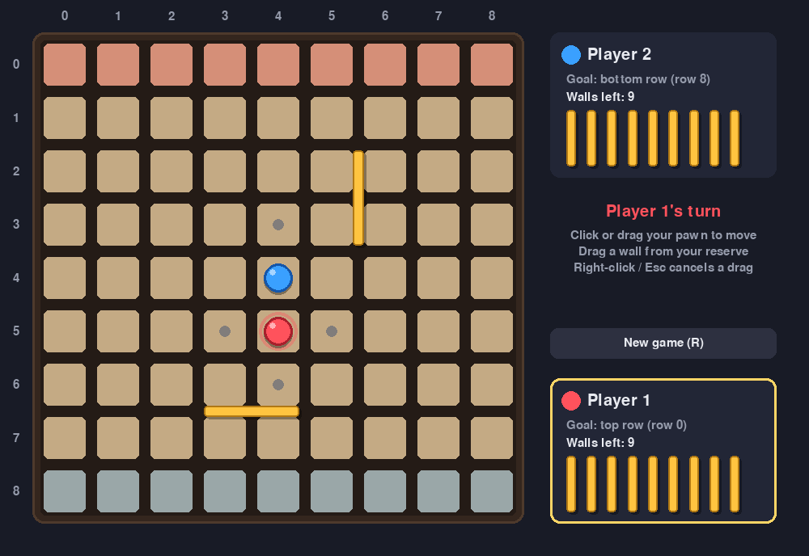

# QuoridorBot

A 2-player [Quoridor](https://en.wikipedia.org/wiki/Quoridor) game emulator in Python, with
three front-ends: a **browser version** (works from a plain link, also on phones), a pygame
desktop GUI and a terminal CLI. Human vs. Human for now; a `BotPlayer` will plug into the same
`Player` interface later.



## Play in the browser

**Online:** once GitHub Pages is on (see below), the game is at
**https://eifel08.github.io/QuoridorBot/**. Share that link and play on one device (pass and play).
Names can be preset in the URL: `https://eifel08.github.io/QuoridorBot/?p1=Alice&p2=Bob`.

**Locally** (Python only, nothing to install):

```bash
python3 main.py --web
```

That serves the `web/` folder at http://localhost:8000 and opens a browser tab
(`--port 9000` to change the port, `--no-browser` to skip opening a tab). Any static file
server works too, e.g. `cd web && python3 -m http.server`.

The web version is plain HTML/CSS/JavaScript in `web/` with no build step and no external
libraries. `web/engine.js` is a port of the Python rules, and `tests/test_web_engine.py`
checks that it computes exactly the same legal moves, legal walls and path lengths as the
Python engine on a few hundred random positions. It also has *Undo*, editable player names,
and a console API (`Quoridor.state()` returns the same dict as `BoardState.to_dict()`).

### Turning on the GitHub Pages link (one-time)

1. Merge this work into the `main` branch.
2. On GitHub: **Settings -> Pages -> Build and deployment -> Source: GitHub Actions**.
3. Every push to `main` then runs the tests and publishes `web/` via
   `.github/workflows/pages.yml` (it can also be started by hand from the *Actions* tab).

## Desktop and terminal versions

Requires Python 3.9+. Install the dependency (pygame, only needed for the desktop GUI):

```bash
pip install -r requirements.txt
```

| Command | Version |
|---|---|
| `python3 main.py` | pygame desktop window |
| `python3 main.py --p1 Alice --p2 Bob` | desktop window with names |
| `python3 main.py --cli` | terminal (no dependencies) |
| `python3 main.py --web` | browser version on localhost |

Run the tests (GUI tests run headless and are skipped without pygame; the web engine test
needs Node.js and is skipped without it):

```bash
python3 -m unittest -v
```

## Controls (browser and desktop GUI)

- **Goal rows** are tinted: the top row (row 0) in red is Player 1's goal, the bottom row
  (row 8) in blue is Player 2's goal. The active player's pawn pulses and their card is outlined.
- **Move the pawn**: click your pawn to show grey dots on every legal destination (jumps
  included), then click one. You can also click a legal square directly, or drag your pawn
  onto it. An illegal drop slides the pawn back.
- **Place a wall**: drag one from your reserve (your card in the side panel) onto the board.
  A semi-transparent preview snaps to the nearest groove:
  - over a **horizontal** groove the wall covers the hovered square and the one **to its left**;
  - over a **vertical** groove it covers the hovered square and the one **below**;
  - if that spot is illegal, the preview tries the spot shifted by one square; if both are
    illegal the preview turns red and dropping sends the wall back with the reason.
- **Right-click / Esc** cancels a drag. Desktop: **R** or *New game* restarts.
  Browser: *New game*, *Undo* (Ctrl+Z); touch works the same as the mouse.

## Rules implemented

- 9x9 board. **Player 1** (`1`) starts at row 8, col 4 and must reach **row 0**.
  **Player 2** (`2`) starts at row 0, col 4 and must reach **row 8**.
- Each player has **10 walls**.
- On a turn you either move your pawn or place a wall.
- Pawns move one square orthogonally. If the opponent is adjacent you may jump
  straight over them; if that jump is blocked by a wall or the board edge you may
  jump diagonally to either side of them instead (unless a wall blocks that side).
- Walls are 2 squares long, horizontal or vertical. They cannot go out of bounds,
  overlap another wall, or cross another wall at its center.
- A wall may not cut off **either** player from their goal row (checked with BFS).

## CLI input format

Coordinates are `row col`, both 0-based; row 0 is the top of the board.

| Command | Meaning | Example |
|---|---|---|
| `m <row> <col>` | Move your pawn to that square (jumps included) | `m 7 4` |
| `w <row> <col> h` | Horizontal wall under squares `(row,col)` and `(row,col+1)` | `w 3 4 h` |
| `w <row> <col> v` | Vertical wall right of squares `(row,col)` and `(row+1,col)` | `w 3 4 v` |
| `moves` | Show your legal pawn moves (marked `*`) | |
| `help` | Show commands | |
| `quit` | End the game | |

For walls, `(row, col)` is the top-left square of the 2x2 block the wall sits in,
so both values range from 0 to 7. Walls are drawn with `#`:

```
      0   1   2   3   4   5   6   7   8
    +---+---+---+---+---+---+---+---+---+
 3  | . | . | . | . | . | . | . | . | . |
    +---+---+---+---+#######+---+---+---+     <- w 3 4 h
 4  | . | . | . | . | . | . | . | . | . |
```

Invalid input or illegal moves are rejected with an explanation and you are asked again.

## Code layout

```
main.py                Launcher: desktop GUI, --cli, --web
requirements.txt       pygame (desktop GUI only)
web/                   Browser version (static site, deployed to GitHub Pages)
  index.html, style.css, app.js   UI: SVG board, drag-and-drop, animations
  engine.js            JS port of the rules (checked against Python by tests)
.github/workflows/     Tests + GitHub Pages deployment
quoridor/
  moves.py             PawnMove / WallMove / Orientation value types
  state.py             BoardState: immutable, serializable snapshot given to players
  board.py             Mutable rules engine: movement/jumps, wall validation, BFS
  player.py            Player (abstract base), CLI HumanPlayer, command parser
  game.py              Game engine + GameObserver hooks for views
  renderer.py, cli.py  ASCII rendering and terminal front-end
  gui/
    layout.py          Pure pixel geometry (squares, grooves, wall snapping)
    app.py             QuoridorGUI: pygame drawing, mouse input, animations
    anim.py, theme.py  Tweens and colors
    player.py          GuiHumanPlayer
tests/                 unittest suite
```

### State vs. rendering

The engine owns the only mutable `Board`. Each turn it builds a frozen `BoardState` and
hands it to the player (`get_move(board_state)`) and to observers such as the GUI. Views only
read snapshots, so drawing can never change the game, and coordinates are never flipped:
row 0 is always the top row for every player.

### Writing a bot

Subclass `Player` and implement `get_move(board_state) -> Move`. The `BoardState` holds
everything needed, so the bot doesn't have to remember anything between turns:

| Field / method | Content |
|---|---|
| `current_player`, `opponent` | Your index (0 or 1) and the other player's |
| `pawns`, `goal_rows`, `walls_left` | Per-player tuples |
| `walls` | `(row, col, Orientation)` for every placed wall |
| `valid_pawn_moves`, `valid_walls` | All legal moves for the player to move |
| `shortest_paths` | BFS distance of each player to their goal |
| `wall_matrix(o)`, `pawn_matrix(p)`, `to_planes()` | 8x8 / 9x9 0-1 grids for ML models |
| `to_dict()`, `to_json()`, `from_dict()` | Serialization |
| `to_board()` | A mutable `Board` copy for search (`apply_move`, `wall_error`, ...) |

`Player.observe(state)` is also called after every move if a bot wants to think on the
opponent's turn.
